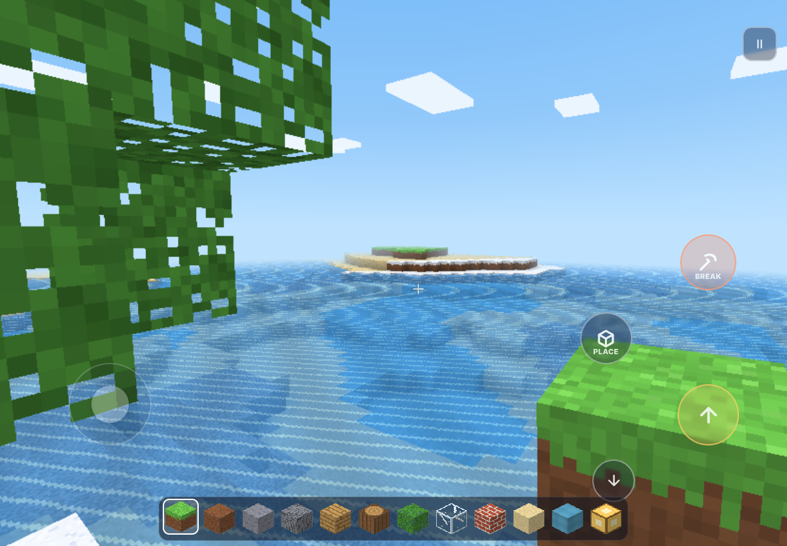
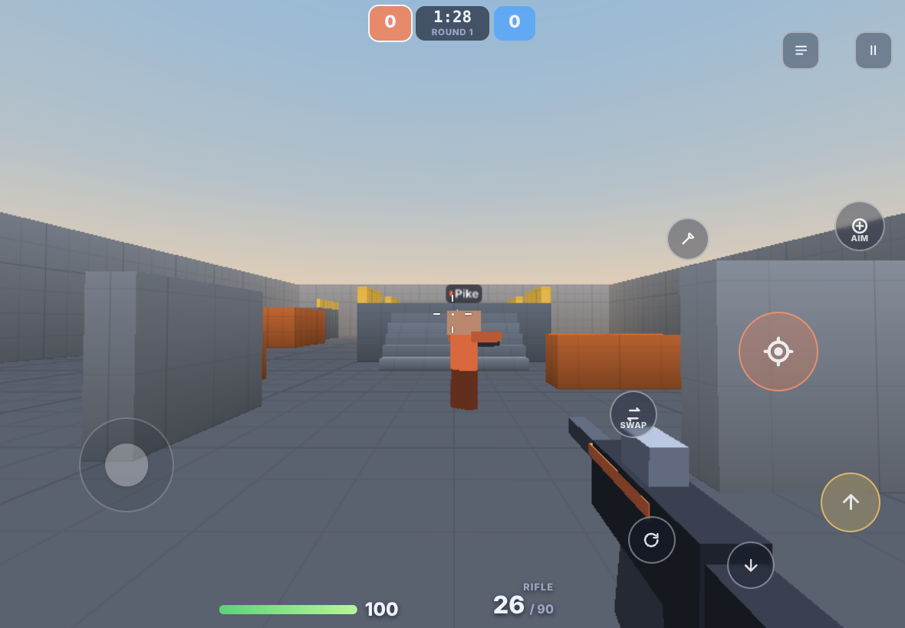

# Cobalt Game Hub

A tablet-first web game hub with **two original online multiplayer 3D games**
that run in the browser, on iPad and Android tablets as well as keyboard and mouse:

| | |
| --- | --- |
| **Voxelvale**: build, explore and race in a shared, procedurally generated block world (sandbox and parkour modes, up to 16 players). | **Arcfire Arena**: fast round-based shooter: 1v1, 2v2 and free-for-all, first to 5 rounds, three maps, five weapons, bots. |
|  |  |

All names, art, music and sound are original. Textures are painted in code, audio is synthesised with WebAudio, and maps and terrain are generated, so there are **no third-party assets** to license and the download stays small.

- **Play it:** https://dhiviyadev.github.io/Mobile_apps/ (GitHub Pages; see [Public website](#public-website-free))
- Build log with per-phase summaries, test instructions and known issues: [`docs/PHASES.md`](docs/PHASES.md)
- More screenshots: [hub](docs/screenshots/hub.png), [parkour](docs/screenshots/voxel-parkour.png), [arena loadout](docs/screenshots/arena-loadout.png)

---

## Tech stack and layout

| Package | What it is |
| --- | --- |
| [`client/`](client) | TypeScript, Vite, Three.js; plain DOM UI (no framework) |
| [`server/`](server) | Node.js, Colyseus 0.18: authoritative rooms over WebSockets |
| [`shared/`](shared) | Deterministic game logic and types used by **both** sides: terrain generation, meshing, physics, weapons, the arena simulation, bots, binary protocols |

```
game-hub/
├── shared/src/
│   ├── voxel/       worldgen (seeded simplex), parkour, light propagation, greedy mesher, flowing water, physics, raycast, protocol
│   ├── arena/       maps, movement, weapons, player step, hitscan, simulation, bots, protocol
│   └── util/        noise, RNG, binary codec, rate limiter, text sanitising
├── server/src/
│   ├── rooms/       HubRoom (codes, reconnect, chat) · VoxelRoom · ArenaRoom · schema
│   ├── voxel/       authoritative world copy, saved-world store, server-side water
│   └── http/        /health and /api/rooms
├── client/src/
│   ├── hub/         landing page, game sheets, launcher, room poller
│   ├── core/        input (touch + keyboard/mouse), renderer, quality, audio, settings, UI
│   ├── games/voxel/ world streaming + workers, sky, player, HUD, multiplayer
│   └── games/arena/ ArenaGame (prediction/interpolation), rendering, HUD, offline + online backends
├── server/Dockerfile, fly.toml, netlify.toml   (../render.yaml for Render)
└── docs/PHASES.md
```

### Key design decisions
- **One simulation, three users.** The arena's `ArenaSimulation` runs on the server for online play, in the browser for practice against bots, and its per-input step (`applyCommand`) drives client-side prediction. Bots send the same input commands as players, so they obey the same rules.
- **Seeded worlds.** Voxelvale terrain is generated identically on every client and on the server from a seed; only edits travel over the network, and only edits are saved (a seed plus a compact edit list per world).
- **Lighting in the mesher.** Sky light and lamp light are flood-filled per chunk in the mesh workers and baked into vertices with smooth (per-corner) averaging, so caves are dark, lamps light their surroundings, and the GPU still does one texture fetch per pixel.
- **Server authority where it matters.** Arena: movement, fire rate, ammo, line of sight and hits are all decided on the server, with lag compensation. Voxelvale: block edits are validated by the server; movement is client-simulated but speed-checked (it's a co-op sandbox).
- **Small first download.** The hub is ~21 KB gzipped JS + ~7 KB CSS. Three.js (~124 KB gz) and each game (~20–25 KB gz) load only when you open one; the network library (Colyseus SDK, ~54 KB gz) loads only when you join a room.

---

## Run it locally

Requirements: **Node.js 20+** and npm 10+.

```bash
cd game-hub
npm install
npm run dev          # game server on :2567 and Vite on :5173, both with hot reload
```

Open http://localhost:5173. **On a tablet:** connect it to the same Wi-Fi and open `http://<your-computer's-LAN-IP>:5173`. The client automatically talks to port 2567 on the same host.

Voxelvale sandbox worlds you build online are saved to `server/data/` (gitignored); delete it to start over.

| Command | What it does |
| --- | --- |
| `npm run dev` | Server and client in watch mode |
| `npm test` | 176 unit and integration tests (Vitest): world generation, lighting, meshing, flowing water, saved worlds, physics, combat rules, lag compensation, full bot matches, real Colyseus rooms over WebSockets |
| `npm run e2e` | 26 browser tests (Playwright, desktop and emulated Android tablet), incl. multi-touch and two-browser multiplayer |
| `npm run typecheck` | `tsc --noEmit` for all three packages |
| `npm run build` | Production builds: `server/dist/index.js` and `client/dist/` |
| `npm start` | Run the built server |

> The first `npm run e2e` uses the Chromium that Playwright 1.56 ships with. Run `npx playwright install chromium` if it isn't installed.

---

## Controls

### Tablet (touch)
| | Voxelvale | Arcfire Arena |
| --- | --- | --- |
| Move | Floating joystick: put your thumb anywhere on the left side; push to the rim to **sprint** | same |
| Look | Drag anywhere on the right | same; **light aim assist** slows the camera over an enemy (toggleable) |
| Actions | **Break** (hold, also steers the camera), **Place** (tap or hold), Jump, Crouch (toggle, stops you falling off edges) | **Fire** (hold, also steers the camera), Aim (toggle), Jump, Crouch, Reload, Swap, Blade |
| Other | Hotbar: tap or slide your finger across it · Chat · Menu | Scoreboard · Chat · Menu |

Every button can be **moved and resized**: Menu → *Edit touch layout*. You can also turn on **left-handed mode**, change button size and opacity, look sensitivity and invert-Y in Settings → Controls.

### Keyboard and mouse
| | Voxelvale | Arcfire Arena |
| --- | --- | --- |
| Move / jump / sprint / crouch | WASD · Space · Shift · Ctrl or C | WASD · Space · — · Ctrl or C |
| Mouse | Left: break · Right: place · Wheel: block | Left: fire · Right: aim · Wheel: weapon |
| Keys | 1–0, -, = hotbar · T chat · Esc menu | 1–3 weapons · R reload · V blade · B loadout · Tab scoreboard · T chat · Esc menu |

---

## Settings and tablet optimisation

- **Quality presets** (Low / Medium / High) are picked automatically by a ≤0.15 s GPU benchmark on first launch ("Auto"), and can be changed or re-tested in Settings → Graphics.
- **Dynamic resolution** lowers the render scale when frames take longer than the budget for ~1 s, and raises it again after ~4 s of headroom.
- **Battery saver** caps games at 30 FPS. Voxelvale **render distance** goes from 2 to 8 chunks, capped per preset (Low 3, Medium 5, High 8).
- **FPS, ping and draw-call** overlay (Settings → Show FPS & ping).
- Volume sliders for master, music and effects. Original synthesised SFX and a generative soundtrack for the menu and each game.
- Landscape is enforced on phones and tablets with a "rotate your device" overlay; **fullscreen** and orientation lock are requested where the browser supports them (Android Chrome; iPadOS Safari supports element fullscreen).
- During play there is no page scroll, pinch-zoom, double-tap zoom, long-press callout or text selection. Safe-area insets keep controls clear of notches.
- iOS: no pointer lock (touch look instead), WebAudio unlocked on the first tap, 16 px inputs (no zoom on focus), and the room is rejoined automatically if Safari reloads the tab.
- The screen is kept awake while playing (Wake Lock API, where available).

### Performance budget
Measured render cost per frame (CPU, Chromium; Voxelvale offline sandbox, seed 12345, with light propagation):

| Scene | Draw calls | Triangles | CPU per frame (median) |
| --- | --- | --- | --- |
| Voxelvale, Low (3 chunks) | 43 | 53 k | 1.0 ms |
| Voxelvale, Medium (5 chunks) | 82 | 128 k | 1.5 ms |
| Voxelvale, High (8 chunks) | 143 | 261 k | 2.2 ms |
| Arcfire Arena, FFA | 9 | 1.5 k | 1.1 ms |

Against the same seed before light propagation, draw calls are unchanged and triangles are 4–9 % higher (faces lit differently are no longer merged). Light is computed in the mesh workers: about 1.5 ms per chunk for the flood fill and about 12 ms for light plus meshing.

Techniques used:
- Greedy meshing with ambient occlusion, generated in Web Workers.
- One texture atlas and one shader for all terrain.
- The whole arena map merged into one mesh.
- Instanced avatars (5–6 draw calls for all players), tracers, sparks and particles.
- Frustum culling plus render-distance culling of chunks.
- Baked per-vertex sky and lamp light (flood-filled in workers; no real-time lights on terrain).
- Pixel-ratio caps per preset.

These figures were captured with software rendering, so they show CPU and scene cost rather than real GPU speed. **Please verify on your target devices** (a base iPad and a low-end Android tablet): see "Known issues" in [`docs/PHASES.md`](docs/PHASES.md).

---

## Public website (free)

The hub is published to **GitHub Pages** by [`.github/workflows/pages.yml`](../.github/workflows/pages.yml):

> **https://dhiviyadev.github.io/Mobile_apps/**

Every push to this branch (or `main`) that touches `game-hub/` runs the typecheck and unit tests, builds the client for that path and deploys it.

**One-time setup:**
1. Turn Pages on: [Settings → Pages](https://github.com/dhiviyadev/Mobile_apps/settings/pages) → *Build and deployment* → Source: **GitHub Actions**. Then re-run the latest *Publish website* run (Actions tab → the run → *Re-run all jobs*).
2. Only if the deploy then reports that the branch "is not allowed to deploy to github-pages": [Settings → Environments → github-pages](https://github.com/dhiviyadev/Mobile_apps/settings/environments) → *Deployment branches* → add `claude/web-game-hub-multiplayer-vs7eqq`, or merge the branch into `main`.

**Without a game server**, the site is built for offline play. Voxelvale offline (sandbox and parkour) and Arcfire Arena against bots work fully, the hub shows "Offline mode", and online buttons explain that online play isn't set up.

**Adding online play (free):**
1. Deploy the game server on Render's free plan. On [Render](https://render.com), choose *New → Blueprint* and pick this repository and branch. [`render.yaml`](../render.yaml) creates `cobalt-hub-server`.
   - Free instances sleep after 15 minutes without players and take about a minute to wake.
   - Worlds are kept in memory until the next restart.
2. Copy the server's address, e.g. `wss://cobalt-hub-server.onrender.com`. Keep its `ALLOWED_ORIGINS` at `*`, or list `https://dhiviyadev.github.io` (plus any custom domain). Add the address as a repository variable: [Settings → Secrets and variables → Actions → Variables](https://github.com/dhiviyadev/Mobile_apps/settings/variables/actions) → `GAME_SERVER_URL`.
3. Re-run *Publish website*. The site now lists rooms and offers Quick Match, private rooms and codes.

### Free custom domain (optional)

`dhiviyadev.github.io/Mobile_apps` is already a free address. For a shorter name, [js.org](https://js.org) gives JavaScript projects a free `*.js.org` subdomain with HTTPS.
- At the time of writing, `cobalt-hub.js.org` was free.
- The request is a pull request from your own GitHub account.

1. Fork [js-org/js.org](https://github.com/js-org/js.org). In `cnames_active.js`, add this line in alphabetical order (just before `"cobalt-kit"`):
   ```js
     "cobalt-hub": "dhiviyadev.github.io/Mobile_apps",
   ```
   Then open the pull request, linking the live site.
2. In this repository:
   - Add the variable `PAGES_CUSTOM_DOMAIN` = `cobalt-hub.js.org`.
   - Re-run *Publish website*. The site is then built for the domain's root, with a `CNAME` file, as js.org checks for.
   - Set the same domain in [Settings → Pages → Custom domain](https://github.com/dhiviyadev/Mobile_apps/settings/pages).
3. Once js.org merges the request (usually within a few days), tick *Enforce HTTPS*. The game is then at **https://cobalt-hub.js.org**.

If you prefer, any domain you own works the same way: point a `CNAME` record at `dhiviyadev.github.io` and set `PAGES_CUSTOM_DOMAIN`.

## Deploy

The client is a static site; the server is one Node process holding game rooms in memory. Voxelvale sandbox worlds are also written to disk (`DATA_DIR`, `/data` in the image), so give the server a persistent volume if worlds should survive deploys and restarts.

### 1. Game server

**Fly.io** (config: [`fly.toml`](fly.toml))
```bash
cd game-hub
fly launch --no-deploy --copy-config   # pick a unique app name, keep the Dockerfile
fly volumes create hub_data --size 1 --region iad   # once; same region as primary_region
fly secrets set ALLOWED_ORIGINS=https://dhiviyadev.github.io   # optional, defaults to "*"; list every site serving the client
fly deploy
# → wss://<app>.fly.dev
```
`fly.toml` keeps one machine running (`auto_stop_machines = "off"`) because rooms live in memory, mounts the `hub_data` volume at `/data` for saved worlds, and gives a stopping server 20 s (`kill_timeout`) to save them. Fly volumes are root-owned, so the container's entrypoint takes ownership of `/data` and then runs the server as the unprivileged `node` user.

**Render** (Blueprint: [`../render.yaml`](../render.yaml)): New → Blueprint → select this repository. It creates the game server as a free Docker web service (`game-hub/server/Dockerfile`, health check `/health`). The client is published on GitHub Pages (see [Public website](#public-website-free)), so point that at `wss://<server>.onrender.com`. Render disks need a paid instance, so the blueprint sets `PERSIST_WORLDS=false`: worlds survive rooms emptying but not restarts, and players are told so. To keep them, uncomment the `disk` block in `render.yaml` and delete `PERSIST_WORLDS`. The blueprint also sets `TRUST_PROXY_HOPS=1`, because Render's proxy appends the client address to `X-Forwarded-For`. It's worth confirming on a live deploy that the server logs your real address.

**Any Docker host**
```bash
cd game-hub
docker build -f server/Dockerfile -t cobalt-hub-server .
docker run -p 2567:2567 -v hub-data:/data -e ALLOWED_ORIGINS=* cobalt-hub-server
```
(Behind a registry rate limit, use `--build-arg NODE_IMAGE=mirror.gcr.io/library/node:22-alpine`.)

### 2. Client (static)

Build with the server's address baked in:
```bash
VITE_SERVER_URL=wss://<your-server> npm run build -w client   # output: client/dist
```

**Cloudflare Pages:** Create project → connect the repo →
- Root directory: `game-hub`
- Build command: `npm ci && npm run build -w client`
- Build output: `client/dist`
- Environment variables: `VITE_SERVER_URL=wss://<your-server>` and `NODE_VERSION=22`

`client/public/_headers` sets long-term caching for hashed assets.

**Netlify:** Add site → import the repo → Base directory `game-hub`. [`netlify.toml`](netlify.toml) supplies the build command and output folder. Add `VITE_SERVER_URL` under Site settings → Environment variables.

You can also point any build at another server with `?server=wss://host` in the URL.

### Configuration

| Variable | Where | Default | Purpose |
| --- | --- | --- | --- |
| `VITE_SERVER_URL` | client build | `ws(s)://<page host>:2567` | Game server WebSocket URL; `none` builds a static site for offline play only |
| `VITE_BASE` | client build | `/` | Path the site is served under (e.g. `/Mobile_apps/` on GitHub Pages) |
| `PORT` | server | `2567` | Listen port |
| `HOST` | server | `0.0.0.0` | Listen address |
| `ALLOWED_ORIGINS` | server | `*` | Comma-separated web origins allowed to use the server over HTTP: matchmaking (joining rooms) and `/api/rooms`. If you restrict it, include every site that serves the client, e.g. `https://dhiviyadev.github.io` and your custom domain |
| `LOG_LEVEL` | server | `info` | `debug`, `info`, `warn`, `error` |
| `DATA_DIR` | server | `./data` (`/data` in the image) | Where saved Voxelvale worlds are written (`worlds/<id>.cvw`) |
| `PERSIST_WORLDS` | server | on | `false`/`0` keeps saved worlds in memory only (until restart) |
| `WORLD_TTL_DAYS` | server | `30` | Saved worlds not visited for this long are deleted |
| `MAX_SAVED_WORLDS` | server | `500` | Most saved worlds kept; a new save evicts the least recently saved world that isn't open |
| `MAX_SAVED_WORLD_BYTES` | server | 850 MiB | Byte budget for world files on disk (same eviction rule) |
| `MAX_MEMORY_WORLD_BYTES` | server | 128 MiB | Byte budget when worlds are kept in memory (`PERSIST_WORLDS=false`) |
| `TRUST_PROXY_HOPS` | server | `0` | Reverse proxies that append to `X-Forwarded-For` (Render: `1`). Used for the rate limit on reopening worlds by code. On Fly.io `Fly-Client-IP` is used automatically; otherwise the TCP peer address is used. Client-supplied headers are never trusted |

---

## Status and known issues
All six phases are complete, plus a follow-up that removed the Voxelvale limitations listed after phase 6; see [`docs/PHASES.md`](docs/PHASES.md) for what each step delivered, how to test it, and the known issues.

**Saved worlds.** Online sandbox worlds are kept when their room empties and across server restarts:
- A private room's world is saved under its room code. Entering that code later reopens it, with the same terrain, builds, water and time of day, for 30 days after the last visit (`WORLD_TTL_DAYS`). Reopening by code is rate limited.
- Quick-match sandbox rooms use eight persistent public worlds; a new public room continues the most recently played free one.
- Worlds autosave every 30 s while changed and on close. Parkour courses are not saved, and a room nobody built in is never written.
- The pause menu says whether, and for how long, the current world is kept. Offline worlds are still saved in the browser.

**Light and water.** Lamps (and parkour checkpoints) light their surroundings, caves and interiors are dark by day, and the block in your hand takes the light where you stand.

Water flows. It spreads up to 7 blocks sideways from its source in total, and a fall doesn't restart the count, so one source on a hillside stays small. It also falls, and dries up when its source is removed.

Online, the server runs the water and sends changes as ordinary edits; offline, the browser does. Water may use at most three quarters of a world's 200 000-edit budget, so floods can't stop players building. The room gets a chat notice when water hits that limit.

Remaining limitations:
- The arena trusts client aim angles (inherent to FPS games); everything else is validated on the server.
- Water is a simple 7-level model: no new sources form, currents don't push players, and a flood cut off by the edit budget resumes only when something nearby changes.
- Other players' avatars are lit by daylight only, not by lamps or cave darkness.
