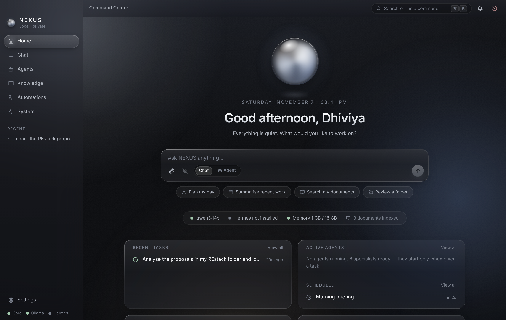

# NEXUS

**Your intelligence. Your machine. Your control.**

NEXUS is a local-first personal AI operating system for macOS on Apple Silicon. It combines a
liquid-glass native desktop app, a floating mini assistant, specialist agents (orchestrated by
[Hermes Agent](https://github.com/NousResearch/hermes-agent) when available), local inference via
[Ollama](https://ollama.com), persistent reviewed memory, a private document knowledge base,
workflow automations and controlled macOS integration — with no cloud dependency.

<p align="center"></p>

## Features

| Area | What you get |
|---|---|
| **Home** | Contextual greeting, ambient orb, central prompt with voice, recent tasks, active agents, scheduled automations, folders, service health |
| **Chat** | Streaming Markdown with code highlighting, attachments with text extraction, persistent history & search, model picker, stop / regenerate / copy / export, read-aloud, source citations, live agent execution timeline |
| **Agents** | Six specialists (Chief of Staff, Researcher, Developer, Analyst, Knowledge, Automation) — configurations, not daemons. Runs on Hermes (API server or CLI) with a NEXUS-native Ollama tool-calling fallback. Status, history, tool usage, per-agent tool permissions |
| **Knowledge** | Explicitly approved folders only; PDF, DOCX, TXT, Markdown, CSV, XLSX, JSON; SQLite FTS5 keyword search + optional local embeddings (hybrid); citations with page/sheet/line; projects; search history; re-index |
| **Memory** | Six categories with provenance; automatic suggestions are proposals until you approve; credential-like content is flagged; review / pin / archive / delete |
| **Automations** | Manual, cron schedule and new-file triggers; conditions; multi-step actions (agent task, prompt, write/append file, notify, re-index, approved script); approvals, retries, history, notifications; templates (morning briefing, weekly summary, document classification, invoice extraction…) |
| **System** | CPU, memory, macOS memory pressure, swap, disk, loaded models with VRAM residency, inference tok/s and TTFT from Ollama's own counters, service health, on-device model benchmark (load time, speed, tool-calling reliability) |
| **Floating assistant** | Separate always-on-top window, ⌥Space to toggle, ⌥⇧Space push-to-talk, expand/collapse, shares conversations and tasks with the main window |
| **Voice** | Push-to-talk with live waveform, local transcription (MLX Whisper or whisper.cpp), local speech (macOS `say` or Piper), interrupt playback |
| **Security** | Loopback-only API with per-install token, DNS-rebinding guard, folder allowlist with separate read/write/execute, no general shell for agents, approvals for destructive actions, emergency stop, Keychain secrets, audit log, cloud off by default |

## Quick start (macOS, Apple Silicon)

```bash
git clone https://github.com/dhiviyadev/Mobile_apps.git && cd Mobile_apps/nexus
./scripts/audit.sh        # Phase 0: read-only report of your Mac, Ollama, Hermes → docs/AUDIT-<host>.md
./scripts/setup.sh        # venv, npm deps, launcher config (asks before installing anything global)
./scripts/dev.sh          # core service + desktop app with hot reload
```

Then pull a model if you don't have one (see [SETUP.md](SETUP.md#choosing-models-for-24-gb)):

```bash
ollama pull qwen3:14b && ollama pull nomic-embed-text
```

Build a standalone `NEXUS.app` + `.dmg`: `./scripts/build.sh`.

## Repository layout

```
nexus/
├── apps/desktop/          Tauri 2 + React + TypeScript desktop app (main window + floating assistant)
│   ├── src/               workspaces/, components/, stores/, hooks/, lib/
│   └── src-tauri/         Rust shell: windows, global shortcuts, tray, core lifecycle
├── services/core/         Python FastAPI core service (package: nexus_core)
│   ├── nexus_core/        api, agents (Hermes adapter, native runtime), models, knowledge,
│   │                      memory, automations, voice, permissions, integrations, tasks, system
│   └── tests/             pytest suite
├── scripts/               audit, setup, dev, build, restore, launchagent, dev/fake_ollama.py
├── docs/                  audit reports, screenshots
└── data/                  runtime data (gitignored): database, workspace, logs, secrets, backups
```

## Documentation

[ARCHITECTURE](ARCHITECTURE.md) · [SETUP](SETUP.md) · [SECURITY](SECURITY.md) · [DEVELOPMENT](DEVELOPMENT.md) · [ROADMAP](ROADMAP.md) (status checklist & known limitations) · [TROUBLESHOOTING](TROUBLESHOOTING.md)
